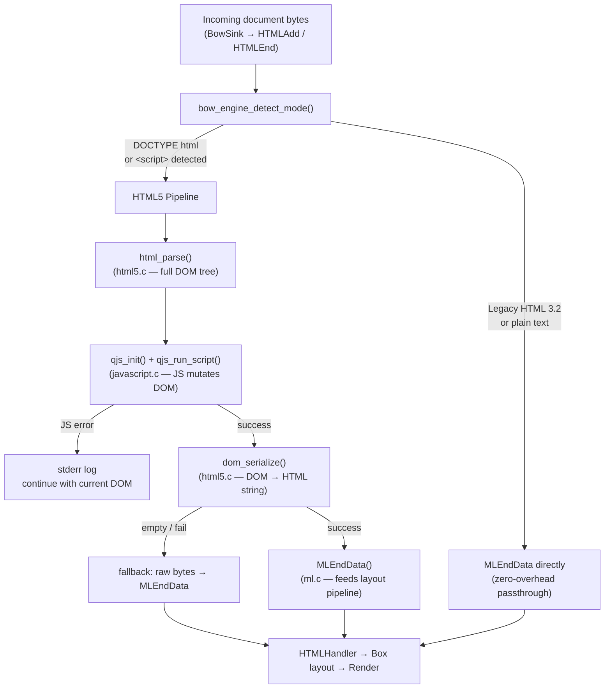

# `bow_engine.c` — Dual-Parser Router Integration

## Summary

Introduces `src/bow/bow_engine.c` as the central document-routing engine that unifies the isolated `html5.c` / `javascript.c` modules with the existing `ml.c`-based layout pipeline, enabling a clean transition from legacy HTML 3.2 to modern HTML5 without breaking existing rendering.

---

## Architecture



---

## Files Created / Modified

### New: [`src/bow/bow_engine.c`](src/bow/bow_engine.c)

Central engine dispatcher. Key components:

| Function | Purpose |
|---|---|
| `bow_engine_detect_mode()` | Heuristic DOCTYPE + HTML5-tag scan to pick parser path |
| `bow_engine_has_html5_doctype()` | Detects `<!DOCTYPE html>` prefix + HTML5 semantic tags |
| `bow_engine_has_script()` | Detects `<script` elements (forces HTML5 pipeline) |
| `bow_engine_html5_pipeline()` | Full HTML5 path: parse → JS → serialize → MLEndData |
| `bow_engine_run_scripts()` | Error-safe QJS initialization + script execution |
| `bow_engine_dom_to_html()` | Wraps `dom_serialize()` from html5.c |
| **`bow_engine_add()`** | Public API: streaming partial chunk (transparent forward) |
| **`bow_engine_end()`** | Public API: final chunk — routes to HTML5 or legacy path |
| **`bow_engine_process()`** | Public API: one-shot complete buffer routing |
| **`bow_engine_inject_html()`** | Inject dynamic HTML fragment into active layout flow |
| **`bow_engine_get_dom_snapshot()`** | Serialise live DOM to HTML string |

### New: [`include/bow_engine.h`](include/bow_engine.h)

Public header declaring all engine entry points. `bow_t` typedef is conditionally aliased from `BowResources` when `Bow.h` is already included, or forward-declared standalone for lightweight consumers.

### Modified: [`src/html/module.c`](src/html/module.c)

The two streaming callbacks now route through the engine:

```c
/* HTMLAdd – partial chunks: transparent pass-through (unchanged) */
bow_engine_add(li->hs, (char *)data, len);

/* HTMLEnd – final chunk: detect → HTML5 pipeline or legacy ml.c */
bow_engine_end(li->hs, li->cres, (char *)data, len);
```

**Legacy HTML 3.2 documents take the same code path as before** — `bow_engine_end` detects them and calls `MLEndData` directly with zero overhead.

### Modified: [`CMakeLists.txt`](CMakeLists.txt)

Added `src/bow/` as a private include directory so `bow_engine.c` can resolve `"javascriptP.h"` (a private header that lives in `src/bow/` but is not installed to `include/`):

```cmake
target_include_directories(${PROJECT_NAME}
    PRIVATE $<BUILD_INTERFACE:${CMAKE_CURRENT_SOURCE_DIR}/include>
    PRIVATE $<BUILD_INTERFACE:${CMAKE_CURRENT_SOURCE_DIR}/src/bow>   # added
    PUBLIC  $<INSTALL_INTERFACE:${CMAKE_INSTALL_INCLUDEDIR}>)
```

`bow_engine.c` is auto-discovered by the existing `file(GLOB lib_files src/bow/*.c)` glob — no explicit source list change needed.

---

## Error Handling Strategy

| Failure point | Recovery |
|---|---|
| `html_parse()` returns NULL | Falls back to raw bytes → `MLEndData` |
| `qjs_init()` fails | JS skipped, DOM rendered as-is (parse + serialize) |
| JS script throws exception | Caught by `run_javascript()`, logged to stderr, execution continues |
| `dom_serialize()` returns empty | Falls back to raw bytes → `MLEndData` |
| All errors combined | Document is **never silently dropped** |

---

## Pipeline Compatibility

> [!IMPORTANT]
> `ml.c`, `MLState`, `MLAddData`, `MLEndData`, and all of `src/html/` (layout, flow, text, table, form, frame…) are **completely unmodified**. The engine sits in front of ml.c as a pre-processor; ml.c remains the sole layout backend.

> [!NOTE]
> The HTML5 pipeline re-serializes the DOM back to HTML text before feeding it to ml.c. This means HTML5-parsed documents are laid out using the existing box/flow/text machinery in `src/html/`, preserving all rendering fidelity. The semantic DOM tree (HtmlDom_t) lives in `javascript.c`'s `gl_ctx.dom_root` for JS-side use while ml.c's `MLState` handles visual layout.

---

## Dual-Parser Router Mechanism

The router uses a **two-level detection heuristic**:

1. **DOCTYPE prefix scan** — O(1), checks the first non-whitespace bytes for `<!DOCTYPE`
2. **HTML5 semantic tag scan** — O(n) over first 4 KB, looks for 25 HTML5-only element names (`<article`, `<section`, `<canvas`, …)
3. **Script element scan** — O(n) over full document, forces HTML5 pipeline whenever `<script` appears (required for correctness)

Legacy HTML 3.2 documents (no DOCTYPE, no HTML5 tags, no scripts) incur **zero extra cost** — they bypass both parsers entirely.
